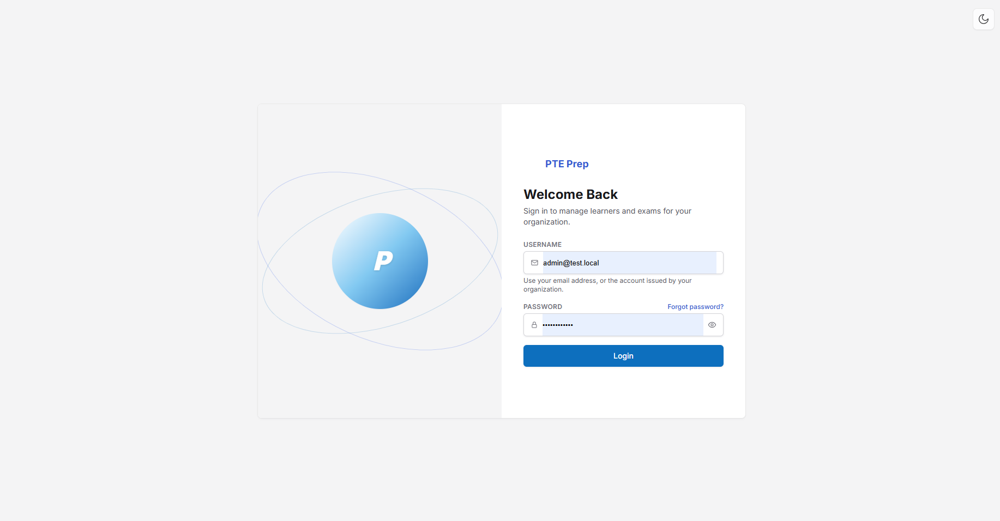
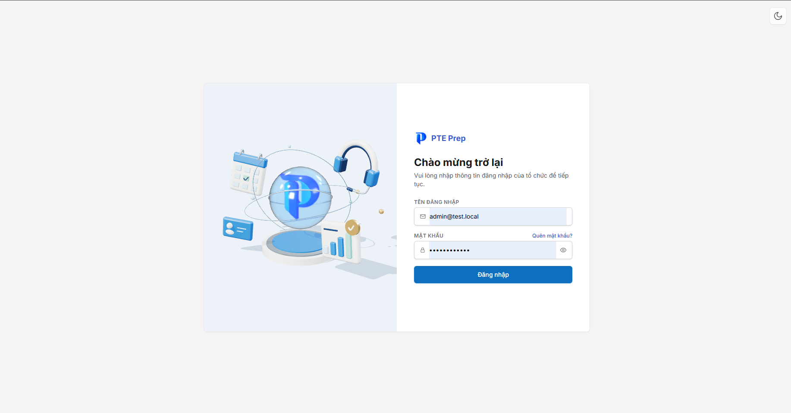
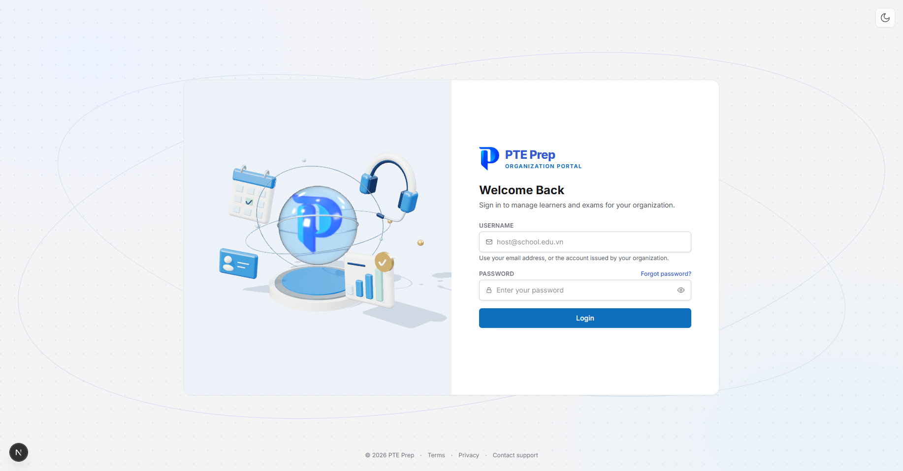
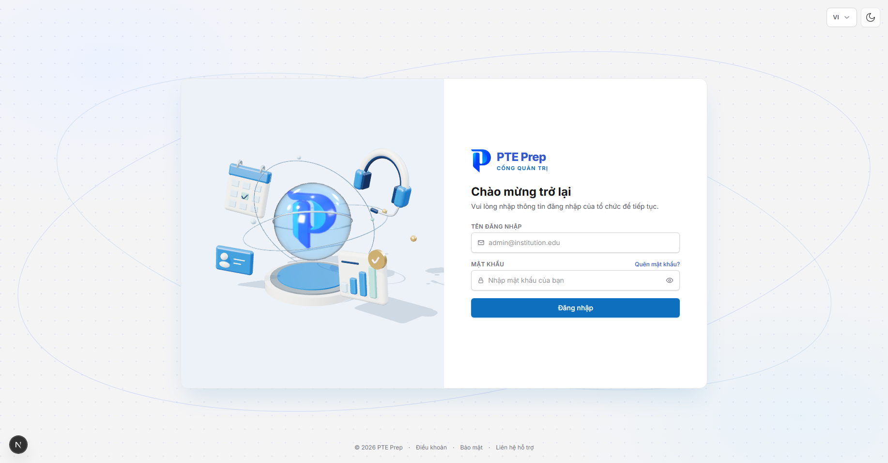
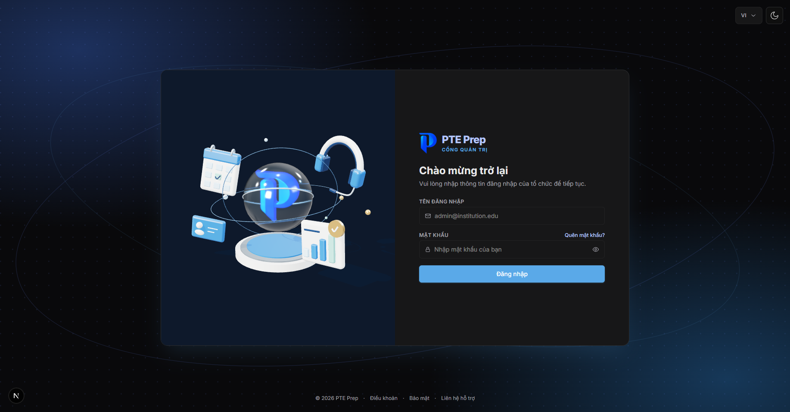
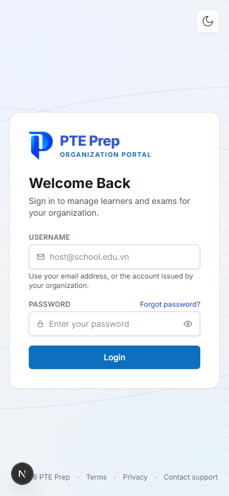

# Báo cáo: Thiết kế lại trang đăng nhập (tenant-web & vendor-web)

**Ngày:** 2026-10-22 · **Người thực hiện:** Phạm Đức Hùng · **Phạm vi:** `apps/tenant-web`, `apps/vendor-web`, `packages/ui`
**Trạng thái:** Đã hoàn thiện UI, chưa commit.

## 1. Vấn đề

- Thẻ đăng nhập rộng khoảng 900px, nằm giữa một nền xám trơn rộng 1834px. Khoảng trắng quá nhiều và trang không có điểm nhấn.
- Logo cạnh chữ "PTE Prep" chỉ được hiển thị trong khung cố định 32×32px nên trông nhỏ hơn hẳn phần chữ.
- Không có dấu hiệu cho biết người dùng đang ở cổng nào (tổ chức hay quản trị).
- Code giao diện của hai trang đăng nhập gần như lặp lại y hệt nhau.

| Trước: tenant-web | Trước: vendor-web |
|---|---|
|  |  |

## 2. Hướng thiết kế đã chọn

Có 3 hướng mockup được đưa ra: V1 nền thương hiệu nhẹ, V2 dải màu navy, V3 bỏ khung thẻ. **Hướng V1** được chọn. Yêu cầu đi kèm là **giữ nguyên hình 3D**, chỉ thiết kế lại phần xung quanh và logo.

## 3. Những gì đã thay đổi

| Hạng mục | Trước | Sau |
|---|---|---|
| Nền trang | Xám trơn `--surface-page` | Hai vầng sáng `--brand-tint` / `--action-tint`, lưới chấm và hai quỹ đạo mờ nối tiếp hình 3D |
| Thẻ đăng nhập | `max-w-4xl` (896px), bo `rounded-lg`, cao 576px | `max-w-[68rem]` (1088px), bo `rounded-2xl`, đổ bóng xanh nhẹ, cao 640px |
| Logo | 32×32px, `object-contain` | Cao 48px, dùng file `logo-mark.png` đã cắt viền trống trong suốt |
| Chữ "PTE Prep" | 18px, đậm | 24px, rất đậm, kèm nhãn cổng bên dưới |
| Nhãn cổng | Không có | tenant-web: "Organization portal". vendor-web: "Admin portal" / "Cổng quản trị"; với `?role=host` là "Cổng tổ chức" |
| Góc trên bên phải | Chỉ có nút giao diện tối | vendor-web có thêm nút đổi ngôn ngữ VI/EN |
| Footer | Không có | "© {năm} PTE Prep · Điều khoản · Bảo mật · Liên hệ hỗ trợ" |
| Hình 3D | Không đổi | Không đổi nội dung; khung panel cao hơn để khớp với thẻ mới |

| Sau: tenant-web | Sau: vendor-web (VI) |
|---|---|
|  |  |

| Sau: chế độ tối | Sau: điện thoại (390px) |
|---|---|
|  |  |

## 4. Thay đổi về code

**Mới trong `@pte/ui`** (`packages/ui/src/layouts/AuthBrandShell.tsx`):
- `AuthBrandShell` là khung trang đăng nhập dùng chung, gồm nền thương hiệu, thanh công cụ, thẻ hai cột và footer. Props: `artwork`, `toolbar`, `footerItems`, `footerLabel`, `children`. Mục footer nào không có `href` sẽ hiển thị dạng chữ thường.
- `AuthBrandLockup` là cụm logo, tên sản phẩm và nhãn cổng. Logo được truyền vào qua slot, vì `@pte/ui` không phụ thuộc Next.js; mỗi app tự render logo bằng `next/image`.
- Test: `AuthBrandShell.test.tsx`, 7 test.

**Trong hai app:**
- `features/auth/components/LoginView.tsx`: phần khung được thay bằng `AuthBrandShell` + `AuthBrandLockup`. Logic đăng nhập, bước chọn tổ chức và xử lý lỗi giữ nguyên.
- `features/auth/components/_AuthBrandPanel.tsx`: chỉ tăng `min-h` của panel 3D.
- `features/auth/constants.ts`: thêm chuỗi nhãn cổng và footer.
- `vendor-web/features/i18n/adminCopy.ts`: thêm 6 bản dịch tiếng Việt.
- `public/logo-mark.png`: logo đã cắt sát nét chữ, kích thước 482×567, lấy từ `logo-ppte.png`. File cũ vẫn được giữ lại.

## 5. Kiểm tra đã chạy

| Kiểm tra | Kết quả |
|---|---|
| `tsc --noEmit` (ui, tenant-web, vendor-web) | Đạt |
| ESLint `features/auth` (tenant-web, vendor-web) | Đạt, 0 cảnh báo |
| Vitest `packages/ui` | 279/279 đạt (có 7 test mới) |
| Vitest `apps/tenant-web` | 540/540 đạt |
| Vitest `apps/vendor-web` | 68/68 đạt |
| Prettier các file đã sửa | Đạt |
| Chụp màn hình thật trên dev server (1834×958, chế độ sáng/tối, điện thoại 390px) | Hiển thị đúng thiết kế, xem ảnh ở mục 3 |

`packages/ui` không có cấu hình ESLint riêng, nên file mới chỉ được kiểm tra bằng typecheck, test và Prettier.

## 6. Hạn chế và việc còn lại

- **Link footer và hỗ trợ:** "Điều khoản", "Bảo mật" và "Liên hệ hỗ trợ" đang là chữ thường vì chưa có trang và email hỗ trợ chính thức. Khi có địa chỉ, chỉ cần thêm `href` vào `footerItems`. Nút "Hỗ trợ" ở thanh công cụ trong mockup V1 chưa được thêm, cũng vì thiếu đích đến.
- **Đổi ngôn ngữ ở tenant-web:** chưa thêm nút đổi ngôn ngữ, vì chữ trên trang đăng nhập của tenant-web hiện chỉ có tiếng Anh. Thêm nút lúc này sẽ không làm thay đổi gì trên trang. Khi trang này được dịch, chỉ cần truyền `toolbar={<LocaleSwitcher />}` giống vendor-web.
- **Độ dài component:** hàm `LoginView` ở cả hai app vẫn dài hơn 150 dòng như trước khi sửa. Lần này chỉ thay phần khung, không tách nhỏ component.
- **`AuthLayout` cũ:** component này trong `@pte/ui` hiện không còn nơi nào dùng. Tôi để nguyên, không xóa trong lần này.
- **Thư mục mockup:** thư mục `.superpowers/` chứa mockup brainstorm, nên thêm vào `.gitignore` hoặc xóa trước khi commit.

---

## 7. Lần 2: bố cục form đầy đặn, hiệu ứng nhập liệu và hình 3D tự về vị trí cũ

**Yêu cầu:** thẻ form vẫn còn trống nhiều. Cần bố trí lại cho cân đối, đầy đặn mà không thêm nội dung mới. Hình 3D phải tự trở về góc nhìn mặc định khi người dùng buông chuột. Cần thêm hiệu ứng khi nhập liệu.

Có hai phương án bố cục được đưa ra (A: nhãn nằm trên ô; B: nhãn nổi trong ô), và **phương án A** được chọn.

### 7.1 Bố cục thẻ form (cả 2 cổng)

| Hạng mục | Lần 1 | Lần 2 |
|---|---|---|
| Cụm logo | Nằm chung khối, cả khối được căn giữa theo chiều dọc | Ghim lên đầu cột; tiêu đề và form căn giữa trong phần còn lại |
| Tiêu đề / dòng phụ | 24px / 14px | 32px rất đậm / 15px |
| Nhãn ô | 12px, chữ in hoa | 13px, chữ thường, đậm vừa |
| Ô nhập | Cao khoảng 42px, bo 6px | Cao 50px, bo 10px, viền 1,5px |
| "Quên mật khẩu?" | Cạnh nhãn mật khẩu | Dưới ô mật khẩu, căn phải |
| Nút Đăng nhập | Cao 40px, màu phẳng | Cao 50px, gradient màu action, có bóng |

### 7.2 Hiệu ứng khi nhập

- Khi bấm vào ô: viền chuyển sang `--brand`, có vầng sáng `ring-4` mờ quanh ô, icon đổi màu và phóng 110%.
- Khi ô có chữ: dấu ✓ màu `--mint-action` nảy vào (scale 50% → 100%, easing có độ nảy). Dấu ✓ chỉ báo "đã nhập", **không** kiểm tra tính hợp lệ.
- Nút Đăng nhập: gradient trượt khi rê chuột, nút thu về 98% khi bấm, mờ đi khi đang xử lý.
- Khi bật `prefers-reduced-motion`: tắt toàn bộ transition (`motion-reduce:transition-none`).

### 7.3 Hình 3D tự về vị trí mặc định

- File mới `packages/ui/src/assets/pte-orbit/home-return.js`, được gắn vào `scene.js`. Mô hình, ánh sáng và chuyển động quỹ đạo không đổi.
- **Kéo xoay:** sau khi buông chuột khoảng 120ms, camera trượt êm về góc nhìn đã lưu bằng `controls.saveState()` trong 0,8 giây (easing ease-out cubic). Camera đi theo đường ngắn nhất, nên kéo gần nửa vòng cũng không quay ngược cả vòng.
- **Cuộn phóng to/thu nhỏ và phím mũi tên:** tự trở về sau khi ngừng thao tác 0,6 giây.
- Bất kỳ thao tác mới nào cũng hủy lượt trượt đang chạy, nên người dùng không bị "giật" lại giữa chừng.
- Khi animation đang tạm dừng, hoặc người dùng bật giảm chuyển động: góc nhìn về vị trí cũ ngay lập tức, không có animation.
- Quán tính (damping) còn lại sau khi kéo được xóa trước khi bắt đầu trượt, để hai chuyển động không chồng lên nhau.
- `pteOrbitAssets.ts`: thêm `home-return.js` vào danh sách file được phục vụ. Tham số phiên bản tăng lên `motion-3` để trình duyệt tải lại.

### 7.4 Thay đổi về code

- **Mới:** `packages/ui/src/components/AuthFormControls.tsx`, gồm `AuthTextField` (nhãn, icon, gợi ý, control phía sau, dấu ✓) và `AuthSubmitButton`. Đi kèm `AuthFormControls.test.tsx` với 5 test.
- **Mới:** `CheckIcon` trong `icons.tsx`.
- `AuthBrandShell`: thêm slot `brand`, được ghim trên đầu cột form. Thêm 1 test.
- `LoginView.tsx` (cả 2 app): dùng `AuthTextField` và `AuthSubmitButton`, bỏ các class ô nhập viết tay. File giảm từ 253 xuống 245 dòng. Logic đăng nhập không đổi.

### 7.5 Kiểm tra đã chạy (lần 2)

| Kiểm tra | Kết quả |
|---|---|
| `tsc --noEmit` (ui, tenant-web, vendor-web) | Đạt |
| ESLint `features/auth` (2 app) | Đạt |
| Vitest `packages/ui` | 285/285 đạt (thêm 6 test mới) |
| Vitest `apps/tenant-web` / `apps/vendor-web` | 540/540 / 68/68 đạt |
| Prettier các file đã sửa | Đạt |
| `node --check` cho `home-return.js` và `scene.js` | Đạt (chỉ kiểm tra cú pháp) |

### 7.6 Chỉnh tiếp: thẻ cao vừa khít form

Sau lần 2, thẻ vẫn cao 640px vì `min-h-[40rem]` của panel 3D, trong khi nội dung form chỉ cao khoảng 540px. Phần dư tạo ra khoảng hở dưới logo và dưới nút Đăng nhập. Tôi đã sửa như sau:
- `_AuthBrandPanel.tsx` (2 app): `md:min-h-[40rem]` → `md:min-h-[34rem]` (544px). Thẻ giờ cao vừa khít nội dung form.
- `AuthBrandShell`: padding dọc của cột form `md:py-11` → `md:py-10`, khoảng cách từ logo xuống tiêu đề `md:pt-6` → `md:pt-7`.
- Đã chụp màn hình kiểm tra cả 2 trang ở 1834×958: form khít, không còn khoảng trống lớn. Vendor-web không có dòng gợi ý dưới ô tên đăng nhập nên thoáng hơn khoảng 24px.

## 8. Lần 3: nền động lấy cảm hứng từ fustation.net/login

**Tham khảo:** sau khi xem trang https://www.fustation.net/login (chụp màn hình và đọc mã JS), tôi thấy nền của họ có 3 lớp: lưới chấm canvas phản ứng theo con trỏ, các dải sáng mềm như lụa chạy chéo, và lớp hạt nhiễu. **Không sao chép code của họ.** Bản của PTE Prep được viết lại từ đầu, dùng token màu của hệ thống.

**File mới `packages/ui/src/layouts/AuthBackdrop.tsx`** thay cho nền tĩnh cũ (gồm lưới chấm SVG và hai quỹ đạo) trong `AuthBrandShell`:

| Lớp | Cách làm |
|---|---|
| Nền | Gradient chéo `--brand-tint` → `--surface-page` → `--shell-border`, tạo chiều sâu để dải sáng nổi lên |
| Dải lụa | 5 dải gradient mờ (`blur-2xl`/`blur-3xl`), mỗi nếp gồm một dải tối `--shell-border` và một dải sáng `--surface-card`, cộng một vệt sáng `--brand-soft`. Các dải trôi chậm bằng keyframes `pte-silk-a/b/c` (24s/31s/38s, ease-in-out), chỉ chạy khi `motion-safe` |
| Lưới chấm tương tác | `<canvas>` 2D, chấm cách nhau 22px. Trong bán kính 150px quanh con trỏ, chấm phồng to (tối đa 2,4 lần), sáng hơn và bị đẩy ra ngoài tối đa 12px, kèm quầng sáng mờ màu `--brand`. Con trỏ và độ mạnh hiệu ứng được làm mượt (ease 0,14/frame); rời chuột thì mọi thứ dịu về |
| Grain | SVG `feTurbulence`, độ mờ 6%, `mix-blend-multiply` |

**Hiệu năng và trợ năng:**
- Canvas chỉ chạy `requestAnimationFrame` khi con trỏ đang di chuyển hoặc đang dịu về; đứng yên thì không vẽ lại.
- Chấm ngoài vùng con trỏ được gom vào một path duy nhất mỗi frame.
- Mật độ điểm ảnh tối đa là 2.
- **Không áp dụng `prefers-reduced-motion` trên trang đăng nhập:** quyết định của người làm sản phẩm, sau khi phát hiện máy dev tắt "Animation effects" của Windows khiến toàn bộ hiệu ứng đứng yên. Lưới chấm, dải lụa, hiệu ứng ô nhập (`AuthFormControls`) và quán tính kéo của hình 3D (`bootstrap.js`: khi nhúng thì truyền `reducedMotion = false`) đều chạy bất kể cài đặt hệ điều hành. Điều này **lệch với quy tắc "Respect prefers-reduced-motion" trong `PRODUCT.md`**; nếu sau này cần tuân thủ lại, chỉ cần khôi phục các class `motion-safe:`/`motion-reduce:` và điều kiện `reducedMotion`.
- Đổi giao diện sáng/tối: `MutationObserver` đọc lại màu `--brand` và vẽ lại.
- Toàn bộ lớp nền có `aria-hidden` và `pointer-events-none`.

**Thay đổi khác:**
- `design-tokens.css`: thêm `--animate-pte-silk-a/b/c` và 3 keyframes.
- `AuthBrandShell.test.tsx`: test cũ về pattern SVG được thay bằng test cho canvas, các dải `motion-safe` và id của grain filter (tổng 286/286 test trong `@pte/ui` đạt).
- Đã chụp màn hình kiểm tra ở chế độ sáng (tenant-web) và chế độ tối (vendor-web).

**Chưa kiểm tra:** ảnh chụp tĩnh không thể hiện được chuyển động. Hiệu ứng lưới chấm theo con trỏ và các dải lụa trôi cần thử tay trên trình duyệt.

## 9. Lần 4: quả cầu trong suốt, màu 3D đậm hơn, aura nền chuyển động

**Yêu cầu:** quả cầu thủy tinh trong suốt hơn; logo trong quả cầu khớp màu logo chính; các khối 3D không bị nhạt (tránh cảm giác "AI pastel", đồng bộ với form); vầng màu (aura) của nền phải chuyển động.

**Hình 3D (`packages/ui/src/assets/pte-orbit/`):**
- `scene.js`: tone mapping đổi từ `ACESFilmicToneMapping` sang `NeutralToneMapping`. ACES làm bạc các mảng xanh tươi; Neutral giữ được sắc độ và độ bão hòa.
- `models.js`, quả cầu kính: bỏ màu pha `0xc4e9ff`, chuyển sang kính không màu `0xffffff`. Thông số mới: `transmission` 0,97 → 1; `thickness` 0,3 → 0,08; `ior` 1,15 → 1,06 (ít méo hình); `envMapIntensity` 1,1 → 0,45 (bớt phản chiếu đục). Màu quỹ đạo mặc định `0x83a4c2` → `0x4a78b8`.
- `logo.js`: màu lấy mẫu từ `logo-mark.png` (royal `#003CF4`, blue `#0058FA`, mid `#0072FB`, cyan `#00AEFB`, trước đây là `0x004fff/0x006fff/0x00beef`). Mặt chữ có thêm `emissive` cùng tông (cường độ 0,15–0,22) và `envMapIntensity` cao hơn, để mặt trước không bị tối khi nhìn qua kính.
- `constants.js`: bảng màu đậm hơn để khớp với form. `blue` `0x1679ce` → `0x0d6fbe` (= `--action`), `navy` → `0x0f2a5c`, `ice` `0xb9e2fc` → `0x6fb2ec`, `mint` `0x7fc5b7` → `0x1fa88c`, `gold` → `0xe2a447`. Màu quỹ đạo theo theme: sáng `0x4a78b8`, tối `0x6f9be0`.
- Tham số phiên bản trong URL tăng lên `motion-4`.

**Aura nền (`AuthBackdrop.tsx` + `design-tokens.css`):** thêm 3 khối màu mờ lớn (`--brand-soft`, `--action-gradient-start`, `--brand-tint`; kích thước 30–42rem, `blur-3xl`). Các khối trôi khắp nền bằng keyframes `pte-aura-a/b/c` (18s/23s/29s), biên độ tới khoảng 22vw/26vh, phóng to/thu nhỏ từ 0,9 đến 1,25 lần. Chúng nằm dưới các dải lụa và lưới chấm.

**Kiểm tra:** `node --check` các file JS của hình 3D đạt; typecheck `packages/ui` đạt; Vitest 286/286 đạt. Đã chụp màn hình và so màu logo 3D với logo 2D ở cùng khung hình. Ảnh chụp dùng chế độ dựng hình bằng phần mềm (SwiftShader), nên màu trên GPU thật có thể tươi hơn.

## 10. Lần 5: logo 3D đúng màu logo chính, hiệu ứng lan tròn khi đổi sáng/tối

### 10.1 Logo 3D

**Nguyên nhân logo 3D vẫn khác logo 2D:**
1. Mặt chữ chịu ánh sáng và bóng đổ nên bị tối.
2. Hướng chuyển màu sai: trước đây cả 4 mảnh dùng chung một công thức trộn gần như ngang.
3. Quan trọng nhất: kính dùng `transmission`. Three.js vẽ logo vào một ảnh trung gian rồi khúc xạ qua kính, làm logo bị **nhòe và lệch màu**.

**Đã sửa:**
- `logo.js`: mặt trước của chữ dùng `MeshBasicMaterial` (không nhận ánh sáng, `vertexColors`, `toneMapped: false`), nên hiển thị đúng màu gốc. Riêng cạnh vát vẫn dùng chất liệu có ánh sáng để giữ khối 3D.
- `logo.js`: mỗi mảnh có gradient riêng, lấy mẫu từ `logo-mark.png` và đi đúng hướng như hình 2D:
  - vòng ngoài từ trái sang phải `#005EFC` → `#003DF5`;
  - thân sau từ trên xuống, từ xanh lơ `#01B2FB` → `#0069FB`;
  - nếp gấp trong chéo `#017DFB` → `#00A8FC`;
  - thân trước từ trên xuống `#0052FB` → `#003CF4`.
- `models.js`: kính chuyển từ `transmission` sang kính trong suốt bằng `transparent` + `opacity: 0.16` + `depthWrite: false`. Lớp clearcoat và specular vẫn giữ để có điểm sáng bóng; `renderOrder = 1` để kính được vẽ sau logo. Kết quả là logo sắc nét, đúng màu, và quả cầu trong suốt hơn.
- Tham số phiên bản URL tăng lên `motion-5`/`motion-6`.
- Đã chụp màn hình và đặt logo 3D cạnh logo 2D để so: logo 3D sắc nét, đúng tông xanh đậm, có dải xanh lơ ở thân trái và nếp gấp.

### 10.2 Hiệu ứng lan tròn khi đổi sáng/tối

- `ThemeToggle.tsx` (dùng chung nên áp dụng cho cả trang đăng nhập và dashboard của 2 cổng): khi bấm, gọi `document.startViewTransition`. Giao diện mới hiện ra theo một vòng tròn `clip-path`, tâm đặt ở nút vừa bấm, nở tới góc xa nhất của màn hình trong 600ms (easing `cubic-bezier(0.4, 0, 0.2, 1)`). Trình duyệt không hỗ trợ API này thì đổi ngay như cũ. Nếu người dùng bấm lần nữa khi hiệu ứng đang chạy, lượt cũ bị bỏ qua mà không gây lỗi.
- `ThemeProvider.tsx`: `setTheme`/`toggleTheme` giờ đổi thuộc tính `data-theme` ngay lập tức (trước đây đổi trong `useEffect`), để View Transition chụp được trạng thái mới. Việc lưu vào `localStorage` vẫn nằm trong effect như cũ.
- `design-tokens.css`: tắt hiệu ứng mờ dần mặc định của `::view-transition-old/new(root)`.
- **Kiểm tra:** dùng Chrome headless bấm nút trên vendor-web: trình duyệt có View Transitions, giao diện chuyển light → dark → light, `aria-pressed` và `localStorage` khớp, không có lỗi. Typecheck ui/tenant/vendor đạt; Vitest ui 286, tenant 540, vendor 68 đều đạt. Hình ảnh vòng tròn lan ra chưa thể chụp lại được, cần thử tay.

**Chưa kiểm tra (lần 2):** lần này theo yêu cầu, tôi không chụp màn hình và không thử UI trên trình duyệt. Hiệu ứng trở về của hình 3D chưa có test tự động, vì `three` được tải từ CDN bên trong iframe, nằm ngoài môi trường Vitest. Cần thử tay: kéo xoay rồi buông, cuộn phóng to rồi dừng, dùng phím mũi tên, và bật chế độ giảm chuyển động.
