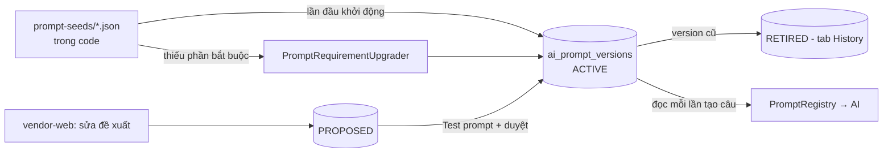
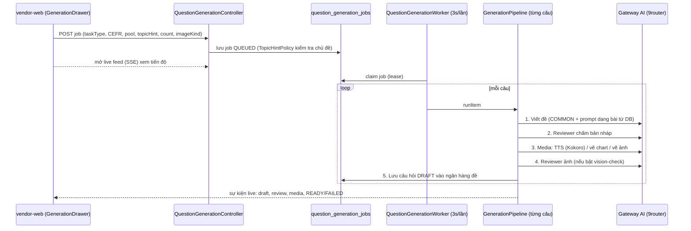

# Luồng tạo đề bằng AI và vai trò của file seed JSON

Ngày: 2026-11-11 · Phạm vi: `pte-api` module `itembank/internal/generation`, vendor-web `questiongeneration` + `aiadmin`.

## 1. Trả lời nhanh: AI đọc prompt từ đâu?

**AI luôn đọc prompt từ DB.** File trong `app/src/main/resources/question-generation/prompt-seeds/*.json`
không bao giờ được gửi cho AI khi tạo đề. Chúng chỉ là **bản mặc định đi kèm code** (seed), dùng trong 2 trường hợp:

| Khi nào | Ai dùng | Làm gì |
|---|---|---|
| App khởi động, DB **chưa có** prompt đó | `PromptSeeder.seedMissing()` | Chèn JSON thành version ACTIVE đầu tiên trong bảng `ai_prompt_versions` |
| App khởi động, prompt trong DB **thiếu phần code bắt buộc** | `PromptSeeder.upgradeRequired()` → `PromptRequirementUpgrader` | Lấy section tương ứng từ seed, tạo version ACTIVE mới, version cũ thành RETIRED (vẫn trong History) |

Nếu prompt đã có trong DB, seed **không ghi đè** — mọi chỉnh sửa trên vendor-web được giữ nguyên.

Tại sao vẫn cần file JSON:

1. **DB mới / DB reset** (dev, CI, deploy lần đầu sau reset V1): không có seed thì không có prompt → không tạo được đề.
2. **Code đổi yêu cầu** (ví dụ thêm `answerHintVi/En`, `image-settings`): seed chứa section mới để upgrader vá vào prompt đang chạy.
3. **Nguồn tham chiếu có version trong git**: review được bằng diff, test đọc để kiểm tra prompt hợp lệ.

Những file đang `M` trong ảnh là do đợt sửa vừa rồi (thêm gợi ý đáp án, xóa field thừa như `taskType`, thêm
`DESCRIBE_IMAGE_PICTURE.json` mới — `U`). Sửa file JSON **không đổi** prompt đã có trong DB của bạn; muốn đổi prompt
đang chạy thì sửa trên vendor-web (AI Admin → Prompts) rồi duyệt.

## 2. Vòng đời của một prompt

- `PromptRegistry` đọc version ACTIVE **mỗi lần** sinh một câu, nên duyệt prompt mới có hiệu lực ngay, không cần restart.
- Nội dung lưu dạng JSON có section/block; `PromptTextAssembler` ghép thành văn bản gửi cho model.
- Section `image-settings` của `DESCRIBE_IMAGE_PICTURE` bị loại khỏi văn bản gửi AI (`PictureSettings.withoutSettings`),
  vì đó là cấu hình cho hệ thống (số lần vẽ, ASK/CHART).
- Các phần code đọc (Instructions, Context, Output field names, answer-hints…) bị khóa bởi `PromptLocks` /
  `PromptRequirements`: không lưu được version thiếu chúng.

### Các loại prompt trong DB

| Kind | Key | Nguồn seed |
|---|---|---|
| `SHARED` | `COMMON_GENERATOR` | `COMMON_GENERATOR.json` — phần chung cho mọi dạng bài |
| `GENERATOR` | 1 key / dạng bài (+ `DESCRIBE_IMAGE_PICTURE`) | `<TASK_TYPE>.json` |
| `REVIEWER` | `REVIEWER`, `IMAGE_REVIEWER`, `PICTURE_REVIEWER` | class Java `*ReviewDefaults` |
| `SCORER` | 1 key / dạng bài chấm bằng AI | sinh từ catalog rubric của module scoring |

## 3. Luồng tạo đề từ đầu đến cuối

### Chi tiết từng bước trong `GenerationPipeline.run`

1. **Chọn generator** theo task type (`LlmItemGenerator`; `StubItemGenerator` cho môi trường không có AI).
2. **Dựng request**: CEFR, chủ đề, `avoidTopics` (chủ đề đã dùng gần đây, tránh trùng), `imageKind`
   (AUTO được quyết định thành CHART hoặc PICTURE dựa trên mô tả chủ đề).
3. **Viết (GENERATING)**: `LlmItemGenerator` lấy `getCommonPrompt()` + `getPrompt(promptKey)` từ DB, thay các token
   `{cefr}`, `{topicHint}`, `{avoidTopics}`, `{lengthRules}` (`GeneratorPromptRenderer`), gọi model, parse JSON thành
   draft (`DraftParser`). Lỗi định dạng → gửi lại cho AI kèm feedback.
4. **Chống trùng**: hash nội dung (`content_hash`, V34). Trùng → viết lại.
5. **Duyệt (REVIEWING)**: `LlmItemReviewer` dùng prompt `REVIEWER` kiểm tra nội dung, CEFR, gợi ý không lộ đáp án.
   Không đạt → `fixSuggestion` thành feedback, quay lại bước 3.
6. **Media (RENDERING_MEDIA)** — chỉ làm sau khi text đã duyệt, tránh tốn tiền TTS/vẽ cho bản nháp sẽ bị viết lại:
   - Audio: Kokoro TTS, hội thoại nhiều giọng; sai độ dài → viết lại với feedback.
   - Chart: `ChartRenderer` vẽ từ số liệu AI sinh.
   - Ảnh minh họa: model `QUESTION_GEN_IMAGE_MODEL`, tối đa `maxImageAttempts` lần. Hết lượt:
     `whenImageFails = CHART` → tự chuyển sang chart; `ASK` → câu FAILED với `GENERATION_IMAGE_FAILED`, vendor-web
     hiện popup hỏi có tạo lại bằng chart không.
7. **Duyệt ảnh**: `ChartImageReviewer` với `IMAGE_REVIEWER` / `PICTURE_REVIEWER`; không đạt → vẽ/viết lại.
8. **Kết thúc**:
   - Job từ form câu hỏi (`saveQuestions=false`): câu ở trạng thái READY để người dùng tự lưu.
   - Job bình thường: `GeneratedQuestionWriter.save` tạo câu hỏi trong ngân hàng đề; lỗi thì xóa media đã lưu.

### Giới hạn và an toàn

- **Ngân sách gọi AI mỗi câu** (`maxCallsPerItem`, `maxCallsPerRound`) giới hạn số vòng viết–duyệt.
  Hết lượt mà reviewer vẫn từ chối → vẫn lưu bản cuối kèm ghi chú reviewer để người hoàn thiện.
- **Lỗi tạm thời của provider** được thử lại; lỗi khác → câu FAILED với mã lỗi trong `QuestionGenerationConstants`.
- **Worker** chạy 1 job một lúc / instance, giữ job bằng lease; app chết giữa chừng thì lease hết hạn và job được chạy tiếp.

## 4. Muốn thay đổi hành vi AI thì sửa ở đâu?

| Mục tiêu | Sửa ở đâu |
|---|---|
| Đổi nội dung/giọng văn đề trên môi trường đang chạy | vendor-web → AI Admin → Prompts → đề xuất → Test → duyệt |
| Đổi prompt mặc định cho DB mới | file `prompt-seeds/*.json` (không ảnh hưởng DB đã có) |
| Thêm field mà code đọc | code (`DraftParser`, `PromptRequirements`) + seed; upgrader tự vá DB khi khởi động |
| Số lần vẽ ảnh, ASK/CHART | section `image-settings` của prompt `DESCRIBE_IMAGE_PICTURE` |
| Model AI, timeout | env `AI_GATEWAY_*`, `QUESTION_GEN_IMAGE_MODEL`, `QUESTION_GEN_IMAGE_MAX_ATTEMPTS` |

## 5. Lưu ý

- DB local của bạn đã sửa trực tiếp `DESCRIBE_IMAGE_PICTURE` (`whenImageFails: ASK`), nên hash không khớp seed —
  vô hại, chỉ khác ở nguồn gốc.
- Nếu muốn một thay đổi trong seed áp lên DB đang chạy, cần làm qua vendor-web, hoặc thêm vào upgrader nếu là phần
  bắt buộc của code.
