# Hướng dẫn vẽ lại ERD và state diagram cho PTE Org

- Cập nhật: 2026-10-26
- Nguồn sự thật: `pte-api/app/src/main/resources/db/migration/V1__baseline.sql` và các lớp `@Entity` trong `pte-api/app/src/main/java/com/pte/**/domain/`
- Phạm vi: modular monolith `pte-api/app`, sau khi gộp entity (45 entity, 52 bảng)

## 1. Vì sao phải vẽ lại

Các ERD hiện có đều vẽ trước đợt gộp entity, khi hệ thống còn khoảng 90 entity:

- `pte-doc/plans/quang-pte-org-review2-erd/`
- `pte-doc/projects/plans/quang-srs-erd-chen-rework/erd/`
- `pte-doc/projects/templates/pte-prep-srs-erd-guide.md`

Sau 12 phase gộp (`pte-doc/projects/plans/quang-entity-consolidation/`), nhiều bảng đã gộp hoặc biến mất. Ví dụ: ba loại đánh giá dùng chung bảng `answer_evaluations`, incident chỉ còn một bảng, và việc ghi danh gộp vào `exam_registrations`. Chỉ dùng các ERD cũ để tham khảo cách trình bày; dữ liệu phải lấy từ V1.

## 2. Bộ sơ đồ cần có

Vẽ theo thứ tự từ trừu tượng tới chi tiết. Mỗi tầng trả lời một câu hỏi khác nhau, nên đừng nhồi chi tiết của tầng sau vào tầng trước.

| # | Sơ đồ | Trả lời câu hỏi | Mức chi tiết | Người đọc |
|---|---|---|---|---|
| D0 | Domain map (bản đồ module) | Hệ thống gồm những vùng nghiệp vụ nào, vùng nào phụ thuộc vùng nào? | Các module trong luồng dữ liệu chính, mũi tên phụ thuộc | Giảng viên, người mới |
| D1 | Conceptual ERD | Nghiệp vụ có những "thứ" gì, quan hệ ra sao? | Thực thể nghiệp vụ và bản số, không có thuộc tính | Giảng viên, BA, SRS |
| D2 | Logical ERD (theo module) | Mỗi thực thể có thuộc tính khóa nào, liên kết bằng gì? | PK, khóa nghiệp vụ, FK, thuộc tính chính, enum | Dev, reviewer |
| D3 | Physical schema | Bảng và cột thật trong PostgreSQL là gì? | Tên bảng, kiểu, ràng buộc, index, bảng con | Dev, DBA |
| D4 | State diagram | Một thực thể chủ chốt đi qua các trạng thái nào, do ai kích hoạt? | Trạng thái, sự kiện, điều kiện | Dev, tester, SRS |

Các file nằm trong [`erd/`](erd/):

```text
erd/
  gen_erd.py                     # sinh D2 + D3 từ V1__baseline.sql
  d0-domain-map.mmd              # viết tay
  d1-conceptual.mmd              # viết tay: tổ chức, nội dung, thi cử
  d1-conceptual-commerce.mmd     # viết tay: thương mại, luyện tập, thông báo, hỗ trợ
  d2-logical-<nhóm>.mmd          # sinh tự động, 7 nhóm ở mục 6
  d3-physical.md                 # sinh tự động, 52 bảng
  d4-state-<entity>.mmd          # viết tay, 16 entity ở mục 8
```

Viết sơ đồ bằng Mermaid để diff được trong git. Để dựng bản trình bày, mở draw.io → Arrange → Insert → Advanced → Mermaid, rồi dán nội dung file `.mmd`. Không sửa trong draw.io mà quên sửa lại `.mmd`.

Chạy `python gen_erd.py` trong `erd/` để sinh lại D2 và D3 từ `V1__baseline.sql`. Script hiện chỉ đọc V1, không áp dụng migration `V2+`. Khi có migration mới, cần cập nhật cách lấy schema nguồn trước khi sinh lại tài liệu; chỉ chạy lại script hiện tại sẽ vẫn cho schema V1. Không sửa tay các file sinh tự động. Nếu có bảng mới trong nguồn, thêm nó vào `GROUPS`; script sẽ in cảnh báo nếu có bảng chưa phân nhóm.

Lưu ý cú pháp Mermaid: không đặt tên thực thể là `CLASS` (từ khoá), dùng `TRAINING_CLASS`.

## 3. Quy ước chung

### 3.1 Hai loại liên kết

Đây là điểm quan trọng nhất khi vẽ cho kiến trúc modulith.

| Loại | Trong DB | Cách vẽ | Ví dụ |
|---|---|---|---|
| FK thật | `FOREIGN KEY ... REFERENCES` | Nét liền | `attempt_answers.attempt_id → exam_attempts` |
| Tham chiếu logic giữa module | Cột UUID `*_public_id` hoặc `tenant_id`, không có FK | Nét đứt, nhãn ghi tên cột | `exam_attempts.session_public_id ⇢ exam_sessions` |

Không suy ra ranh giới module chỉ từ FK: V1 vẫn có FK xuyên module, chẳng hạn `programs.organization_id → organizations.id` và `notification_inbox_snapshots.recipient_user_public_id → users.public_id`. Nhiều liên kết khác giữa module dùng UUID nhưng không có FK. Chỉ vẽ nét liền khi V1 có constraint thật; nếu vẽ mọi liên kết bằng nét liền, người đọc sẽ hiểu sai mức toàn vẹn tham chiếu mà DB đảm bảo.

Toàn bộ FK thật trong V1 (19 FK):

| Bảng con | Cột | Bảng cha |
|---|---|---|
| `organization_members` | `user_id` | `users` |
| `organization_member_roles` | `member_id` | `organization_members` |
| `user_roles` | `user_id` | `users` |
| `programs` | `organization_id` | `organizations` |
| `organization_quota_grants` | `organization_id` | `organizations` |
| `classes` | `program_id` | `programs` |
| `class_students` | `class_id` | `classes` |
| `class_lecturers` | `class_id` | `classes` |
| `question_options` | `question_id` | `questions` |
| `blueprint_items` | `blueprint_id` | `exam_blueprints` |
| `exam_definition_items` | `exam_definition_id` | `exam_definitions` |
| `exam_version_items` | `exam_version_id` | `exam_versions` |
| `exam_session_proctors` | `session_id` | `exam_sessions` |
| `exam_session_audience_sources` | `session_id` | `exam_sessions` |
| `exam_session_selected_skills` | `session_id` | `exam_sessions` |
| `exam_registrations` | `session_id` | `exam_sessions` |
| `attempt_answers` | `attempt_id` | `exam_attempts` |
| `order_payments` | `order_id` | `orders` |
| `notification_inbox_snapshots` | `recipient_user_public_id` | `users` |

### 3.2 Cột lặp lại: không vẽ ở D1/D2

Mọi bảng entity kế thừa `BaseEntity`: `id` (bigint PK nội bộ), `public_id` (UUID dùng ra ngoài API), `created_at`, `updated_at`, `deleted` (xóa mềm).

- D1: bỏ hết.
- D2: chỉ ghi `public_id` là khóa định danh. Thêm một chú thích chung "mọi bảng có cột audit và xóa mềm".
- D3: ghi đủ.

`tenant_id` (UUID của `organizations`) là ranh giới đa tenant. Ở D2, đánh dấu bằng ký hiệu riêng (ví dụ `tenant_id FK~ "tenant"`) thay vì vẽ 20 đường nối về `organizations`.

### 3.3 Màu theo module

Dùng cùng một bảng màu cho D0, D1 và D2 để người đọc nhận ra module ở mọi tầng:

| Module | Màu gợi ý |
|---|---|
| tenancy, identity | xanh dương |
| enrollment | xanh lá |
| itembank, assessment | tím |
| session, attempt, proctoring | cam |
| scoring, reporting | đỏ |
| practice | vàng |
| billing | nâu |
| media, notification, support | xám |
| shared (audit, idempotency) | trắng, viền đứt |

### 3.4 Ký hiệu bản số

Dùng crow's foot (`||--o{` trong Mermaid). Nếu SRS bắt buộc ký hiệu Chen, chỉ vẽ Chen ở D1 và giữ crow's foot cho D2/D3.

## 4. D0 – Domain map

Danh sách được kiểm trong `ModuleStructureTest` hiện có 17 module nghiệp vụ và `shared` (gồm audit và idempotency). D0 dưới đây là bản giản lược các luồng dữ liệu chính; chưa thể hiện hai module `examstaff` và `overview`, nên không dùng để đếm toàn bộ module hoặc xác nhận dependency Spring Modulith:

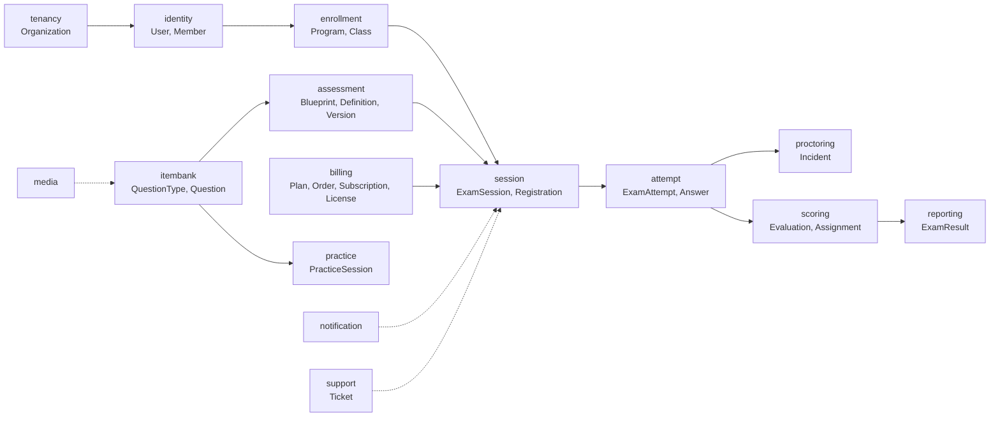

Mũi tên `A --> B` nghĩa là B dùng dữ liệu của A. Nét đứt là module hạ tầng mà nhiều module gọi tới. Trước khi chốt, đối chiếu chiều mũi tên với `ADR-001-module-boundaries.md` và `ADR-008-modulith-reconciliation.md`.

## 5. D1 – Conceptual ERD

### 5.1 Thực thể nghiệp vụ nên có

Gộp entity kỹ thuật lại thành khái niệm nghiệp vụ. Không đưa vào D1 các bảng sau: `refresh_tokens`, `otp_challenges`, `idempotency_keys`, `audit_logs`, `platform_settings`, `notification_recipient_streams`, `notification_inbox_snapshots`, `notification_logs`.

| Khái niệm | Entity / bảng gốc |
|---|---|
| Tổ chức (tenant) | `Organization` |
| Người dùng | `User` |
| Thành viên tổ chức (có vai trò) | `OrganizationMember` + `organization_member_roles` |
| Chương trình đào tạo | `Program` |
| Lớp học | `TrainingClass` (`classes`) |
| Học viên trong lớp / Giảng viên lớp | `ClassStudent`, `ClassLecturer` |
| Dạng câu hỏi | `QuestionType` |
| Câu hỏi (có lựa chọn) | `Question` + `question_options` |
| Khung đề (blueprint) | `ExamBlueprint` + `blueprint_items` |
| Mẫu đề thi (definition) | `ExamDefinition` + `exam_definition_items` |
| Phiên bản đề đã sinh | `ExamVersion` + `exam_version_items` |
| Ca thi | `ExamSession` |
| Ghi danh ca thi | `ExamRegistration` |
| Giám thị ca thi | `ExamSessionProctor` |
| Lượt làm bài | `ExamAttempt` |
| Câu trả lời | `AttemptAnswer` |
| Đánh giá câu trả lời (AI / giám khảo) | `AnswerEvaluation` → `AiEvaluation`, `ExaminerEvaluation` |
| Phân công chấm | `GradingAssignment` |
| Vấn đề khi chấm | `GradingIssue` |
| Kết quả thi | `ExamResult` |
| Sự cố coi thi | `ExamIncident` |
| Phiên luyện tập / câu trả lời luyện tập | `PracticeSession`, `PracticeResponse` |
| Gói dịch vụ | `ServicePlan` |
| Đơn hàng / thanh toán | `Order`, `OrderPayment` |
| Thuê bao | `Subscription` |
| Mã license | `LicenseCode` |
| Tệp media | `MediaAsset` (`media_objects`) |
| Thông báo / thông báo hệ thống | `Notification`, `NotificationRecipient`, `Announcement` |
| Phiếu hỗ trợ | `SupportTicket`, `SupportTicketNote` |

### 5.2 Quan hệ và bản số

| Quan hệ | Bản số | Ghi chú |
|---|---|---|
| Tổ chức có Thành viên | 1 – N | Một User có thể thuộc nhiều tổ chức qua `OrganizationMember` (N – N) |
| Tổ chức mở Chương trình | 1 – N | |
| Chương trình gồm Lớp | 1 – N | |
| Lớp có Học viên / Giảng viên | N – N | qua `ClassStudent` / `ClassLecturer` |
| Dạng câu hỏi phân loại Câu hỏi | 1 – N | qua `task_type_key` |
| Câu hỏi có bản sửa đổi | 1 – N (tự tham chiếu) | `revision_group_public_id`, `supersedes_public_id` |
| Khung đề chọn Câu hỏi | N – N | qua `blueprint_items` |
| Mẫu đề quy định dạng câu theo kỹ năng | 1 – N | `exam_definition_items` |
| Mẫu đề sinh Phiên bản đề | 1 – N | Phiên bản là ảnh chụp (snapshot) câu hỏi tại lúc sinh |
| Tổ chức mở Ca thi | 1 – N | |
| Ca thi dùng Mẫu đề / Phiên bản đề | N – 1 | |
| Ca thi tiêu thụ Thuê bao | N – 1 | `subscription_id` |
| Ca thi có Ghi danh | 1 – N | Ghi danh nối Ca thi với Học viên |
| Ca thi có Giám thị | 1 – N | vai trò `LEAD_PROCTOR` / `ASSISTANT_PROCTOR` |
| Học viên có Lượt làm bài trong Ca thi | 1 – N | `attempt_number`, giới hạn bởi `max_retries_per_student` |
| Lượt làm bài gồm Câu trả lời | 1 – N | |
| Câu trả lời có Đánh giá | 1 – N | AI và giám khảo cùng đánh giá một câu; `selected_evaluation_public_id` chọn điểm cuối |
| Giám khảo nhận Phân công chấm cho Lượt làm bài | 1 – N | |
| Phân công chấm có Vấn đề | 1 – N | |
| Lượt làm bài có Kết quả | 1 – 0..1 | Chỉ có khi đã chấm xong |
| Lượt làm bài có Sự cố | 1 – N | |
| Học viên có Phiên luyện tập, Phiên gồm Câu trả lời luyện tập | 1 – N, 1 – N | |
| Gói dịch vụ có Đơn hàng | 1 – N | |
| Đơn hàng có Thanh toán | 1 – N | webhook PayOS, có thể lặp |
| Gói dịch vụ / Tổ chức có Thuê bao | 1 – N | Thuê bao kích hoạt bởi `PAYMENT` hoặc `LICENSE_CODE` |
| Mã license tạo ra Thuê bao | 1 – 0..1 | |
| Tổ chức gửi Phiếu hỗ trợ, Phiếu có Ghi chú | 1 – N, 1 – N | Phiếu trỏ đa hình tới `EXAM_SESSION` / `EXAM_ATTEMPT` / `QUESTION` |

### 5.3 Mẫu Mermaid D1 (rút gọn, chỉ phần lõi thi)

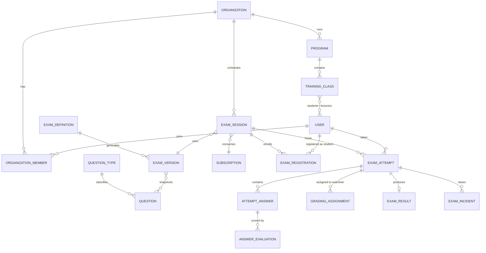

Nếu D1 có hơn khoảng 25 hộp, tách làm hai sơ đồ: "Tổ chức và thi cử" và "Thương mại và hỗ trợ".

## 6. D2 – Logical ERD theo module

Mỗi file là một nhóm module. Vẽ thực thể của nhóm đó đầy đủ, còn thực thể của module khác chỉ là hộp rỗng có viền đứt, nối bằng nét đứt.

| File | Module | Bảng chính | Bảng con (FK thật) |
|---|---|---|---|
| `d2-logical-org.mmd` | tenancy, identity, enrollment | `organizations`, `users`, `organization_members`, `programs`, `classes`, `class_students`, `class_lecturers` | `organization_quota_grants`, `organization_member_roles`, `user_roles` |
| `d2-logical-content.mmd` | itembank, assessment, media | `question_types`, `questions`, `exam_blueprints`, `exam_definitions`, `exam_versions`, `media_objects` | `question_options`, `blueprint_items`, `exam_definition_items`, `exam_version_items` |
| `d2-logical-exam.mmd` | session, attempt, proctoring | `exam_sessions`, `exam_registrations`, `exam_session_proctors`, `exam_session_audience_sources`, `exam_attempts`, `attempt_answers`, `exam_incidents` | `exam_session_selected_skills` |
| `d2-logical-scoring.mmd` | scoring, reporting | `answer_evaluations`, `grading_assignments`, `grading_issues`, `exam_results` | — |
| `d2-logical-practice.mmd` | practice | `practice_sessions`, `practice_responses`, `otp_challenges` | — |
| `d2-logical-billing.mmd` | billing | `service_plans`, `orders`, `order_payments`, `subscriptions`, `license_codes`, `platform_settings` | — |
| `d2-logical-comms.mmd` | notification, support, shared | `notifications`, `notification_recipients`, `notification_recipient_streams`, `notification_announcements`, `notification_logs`, `support_ticket`, `support_ticket_note`, `audit_logs`, `idempotency_keys` | `notification_inbox_snapshots` |

Thuộc tính nên ghi ở D2 (không ghi hết cột):

- Khóa: `public_id` PK, các khóa nghiệp vụ duy nhất (`organizations.code`, `users.email` / `username`, `exam_sessions.session_code`, `orders.order_code`, `license_codes.code`, `exam_definitions.code` + `version`).
- Tham chiếu: mọi cột `*_id` / `*_public_id`.
- Trạng thái: cột `status` và tên enum. Chi tiết chuyển trạng thái để ở D4.
- Thuộc tính quyết định nghiệp vụ: `capacity`, `opens_at` / `closes_at`, `max_retries_per_student`, `price`, `duration_days`, `score`, các cột `*_score` của `exam_results`.

Những điểm dễ vẽ sai:

1. **`answer_evaluations` là kế thừa single-table.** `AnswerEvaluation` (abstract) có hai lớp con `AiEvaluation` và `ExaminerEvaluation`, phân biệt bằng cột `source`. D2 vẽ một hộp và ghi chú hai lớp con. Cột `ai_*` chỉ có giá trị khi là AI, cột `examiner_*` / `decision_kind` / `draft_version` chỉ có giá trị khi là giám khảo. Nếu muốn thể hiện kế thừa rõ, vẽ thêm một class diagram nhỏ bên cạnh.
2. **Phiên bản đề là snapshot.** `exam_version_items` sao chép nội dung câu hỏi (`prompt_text`, `options_json`, các cột `runtime_*`) và giữ `source_question_public_id` để truy vết. Vẽ nét đứt có nhãn "snapshot of", không phải quan hệ sở hữu.
3. **`exam_registrations` gánh ba trục trạng thái:** ghi danh (`status`), điểm danh (`attendance_status`) và xác minh danh tính (`identity_status`). Không tách thành ba bảng.
4. **Câu hỏi có hai cờ pool:** `available_for_exam` / `available_for_practice`, cùng cột `pool`. Practice và exam dùng chung bảng `questions`.
5. **`support_ticket` trỏ đa hình:** `entity_type` + `entity_id`. Vẽ một nét đứt tới mỗi đích có nhãn `entity_type = ...`.
6. **Tham chiếu tới người dùng** gồm `student_public_id`, `examiner_public_id`, `proctor_public_id`, `author_user_public_id`, `reporter_public_id`. Tất cả trỏ tới `users.public_id`, vai trò nằm trong tên cột.

## 7. D3 – Physical schema

Không vẽ lại 52 bảng bằng tay. Dùng một trong hai cách:

1. Sinh tự động: chạy V1 trên một Postgres trống, rồi xuất bằng DBeaver (ER Diagram) hoặc `schemaspy`, tách theo nhóm ở mục 6.
2. Bảng mô tả `d3-physical.md`: mỗi bảng ghi tên, PK, FK, unique/check/exclusion constraint và index chính. Dẫn link tới dòng tương ứng trong V1.

Cần thể hiện rõ:

- 9 bảng không phải entity: element collection và bảng con `@ElementCollection` / `@OneToMany` (`question_options`, `blueprint_items`, `exam_definition_items`, `exam_version_items`, `organization_member_roles`, `user_roles`, `exam_session_selected_skills`, `organization_quota_grants`) và store native `notification_inbox_snapshots`. Cộng với 43 bảng entity là đủ 52 bảng (45 entity, trong đó ba lớp evaluation dùng chung một bảng).
- Các CHECK enum (`status IN (...)`).
- Exclusion constraint `no_overlap_per_subscription` trên `exam_sessions`: các ca `SCHEDULED` / `OPEN` cùng một `subscription_id` không được chồng khoảng `[opens_at, closes_at)`.
- Cột `version` / `lock_version` dùng cho optimistic locking.

Khi có migration `V2+`, cập nhật nguồn schema và cách sinh trước khi làm mới D3; generator hiện chỉ đọc V1. D1 cần sửa khi nghiệp vụ đổi; D2 cần sinh lại khi schema nguồn đổi.

## 8. D4 – State diagram cho entity chủ chốt

Các sơ đồ dưới đây đã đối chiếu với code ngày 2026-10-26 (phương thức domain, service, câu SQL của store). Khi vẽ bản chính thức, giữ nguyên tên trạng thái theo enum và ghi tên hành động/API trên mũi tên.

Ưu tiên vẽ theo thứ tự: ExamSession → ExamAttempt → AnswerEvaluation → Question → ExamDefinition → Organization → Order/Subscription/LicenseCode → các entity còn lại.

### 8.1 ExamSession (`session/domain/ExamSession.java`, `ExamPublishService`, `SessionStateService`)

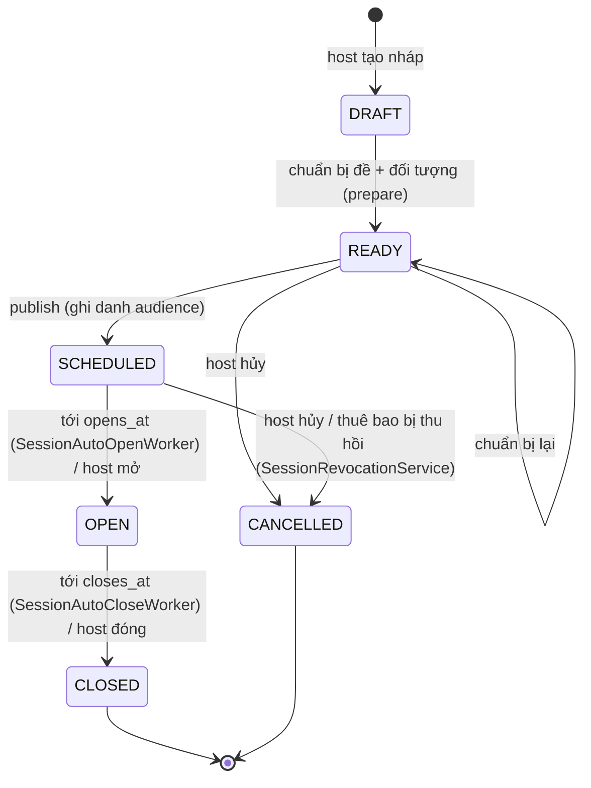

Trục phụ `grading_status` chỉ có khi ca đã `CLOSED`. Cột này là `null` cho tới khi host chốt cách chấm; enum không có giá trị `NONE`.

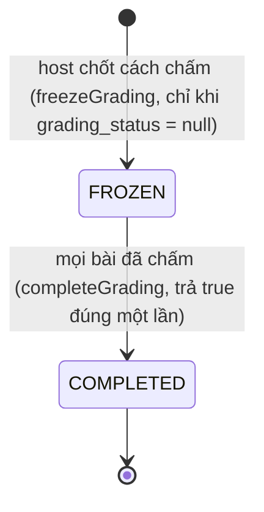

Trên sơ đồ, ghi chú trạng thái khởi đầu là "chưa chốt (null)".

Ghi chú khi vẽ: `publication_locked_at` khóa việc công bố kết quả. Lặp lại cùng một lần công bố thì không đổi gì, công bố khác thì bị từ chối.

### 8.2 ExamRegistration (`AudienceResolver`, `ExamPublishService`, `EnrollmentService`)

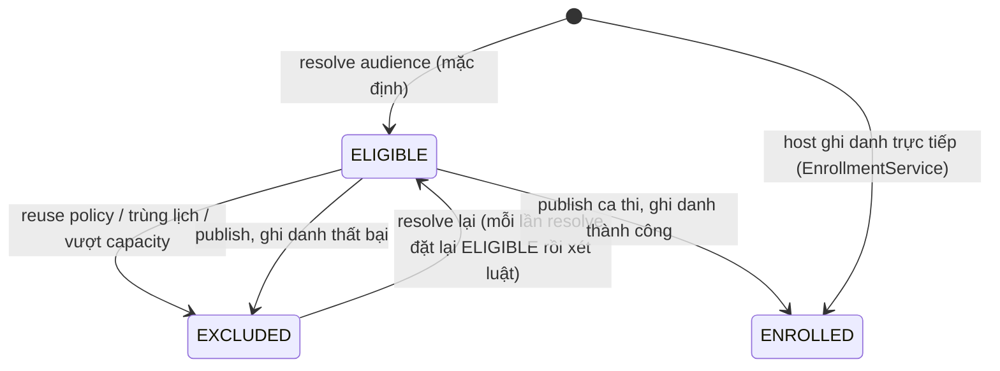

`reason` của `EXCLUDED`: `DUPLICATE_SOURCE`, `ALREADY_ASSIGNED`, `ALREADY_STARTED`, `SCHEDULE_OVERLAP`, `OUTSIDE_TENANT`, `CAPACITY_EXCEEDED`. `AudienceResolver` đặt ba lý do theo `reuse_policy` của ca (`ALREADY_ASSIGNED`, `ALREADY_STARTED`, `SCHEDULE_OVERLAP`) và loại các học viên vượt `capacity`.

Không vẽ `CANDIDATE`. Giá trị này có trong enum và CHECK nhưng không đoạn code nào gán nó. Ghi vào mục "enum thừa" ở 8.12.

Điểm danh và danh tính vẽ thành hai vùng song song (`--`) trong cùng sơ đồ. Cả hai đều do người dùng đặt thẳng giá trị đích, không có ràng buộc thứ tự:

- `attendance_status` (`AttendanceCommandService`): `UNMARKED` → `PRESENT` | `ABSENT` | `LATE`, sửa qua lại được.
- `identity_status` (`IdentityVerificationService`): `UNVERIFIED` → `VERIFIED` | `FAILED`.

### 8.3 ExamAttempt (`attempt/domain/ExamAttempt.java`)

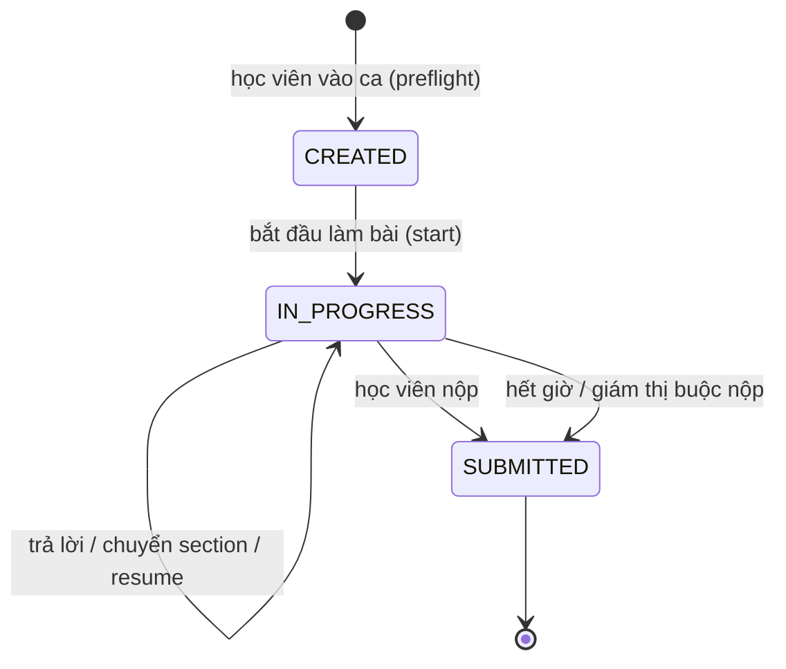

Ghi chú: `grading_excluded` + `grading_exclusion_reason` loại một lượt khỏi việc chấm mà không đổi `status`. Trên sơ đồ, ghi đây là cờ, không phải trạng thái.

`AttemptAnswer.status`: `SUBMITTED` → `SCORED`.

### 8.4 AnswerEvaluation – chấm AI (`ScoringAnswerStatus`)

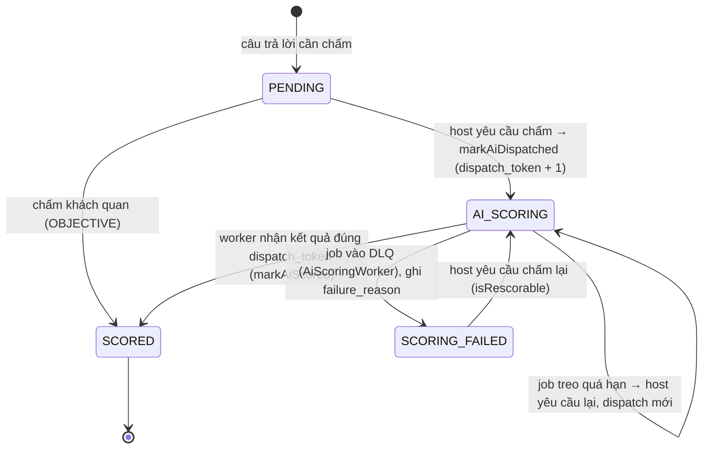

Ghi chú khi vẽ:

- Không có worker tự thử lại. Việc dispatch lại chỉ xảy ra khi host gửi yêu cầu chấm và `isRescorable` đúng: đang `SCORING_FAILED`, hoặc đang `AI_SCORING` mà chưa dispatch hay đã dispatch trước mốc stale (cấu hình trong `AiProviderProperties`).
- Mỗi lần dispatch tăng `dispatch_token`. Kết quả về muộn của job cũ bị bỏ qua (`isAwaitingAiResult(token)`).
- RabbitMQ: queue `scoring.ai-scoring-jobs`, dead letter `scoring.ai-scoring-jobs.dlq`.

Với `ExaminerEvaluation`, `examiner_status`: `DRAFT` → `SUBMITTED`. `decision_kind` (`CONFIRM_AI`, `MANUAL`, `LEGACY_IMPORTED`) cho biết giám khảo giữ điểm AI hay chấm tay.

### 8.5 GradingAssignment (`ExaminerWorkflowStatus`)

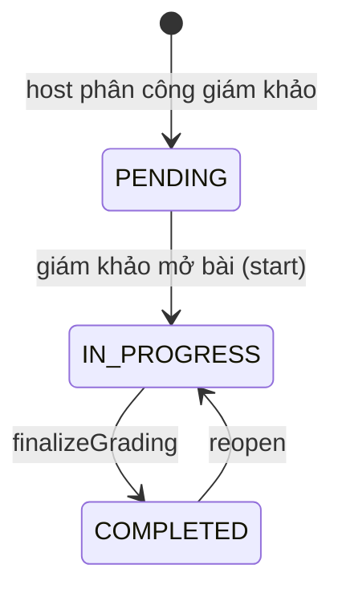

`GradingIssue`: `OPEN` → `RESOLVED`, loại `AUDIO_UNAVAILABLE` / `MEDIA_UNAVAILABLE` / `RESPONSE_DATA` / `OTHER`.

### 8.6 Question (`QuestionApprovalService`, `QuestionLifecycleService`, `QuestionLifecyclePolicy`)

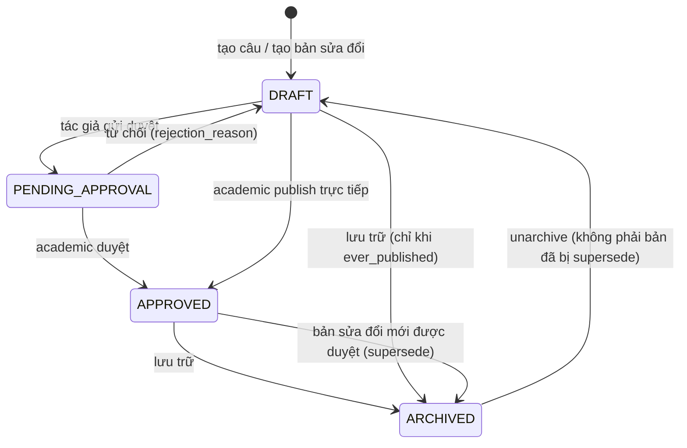

Ghi chú: `is_current` đánh dấu bản hiện hành trong `revision_group_public_id`. Khi duyệt một bản sửa đổi, bản cũ (`supersedes_public_id`) tự chuyển `ARCHIVED`.

### 8.7 ExamDefinition (`ExamDefinitionApprovalWorkflow`)

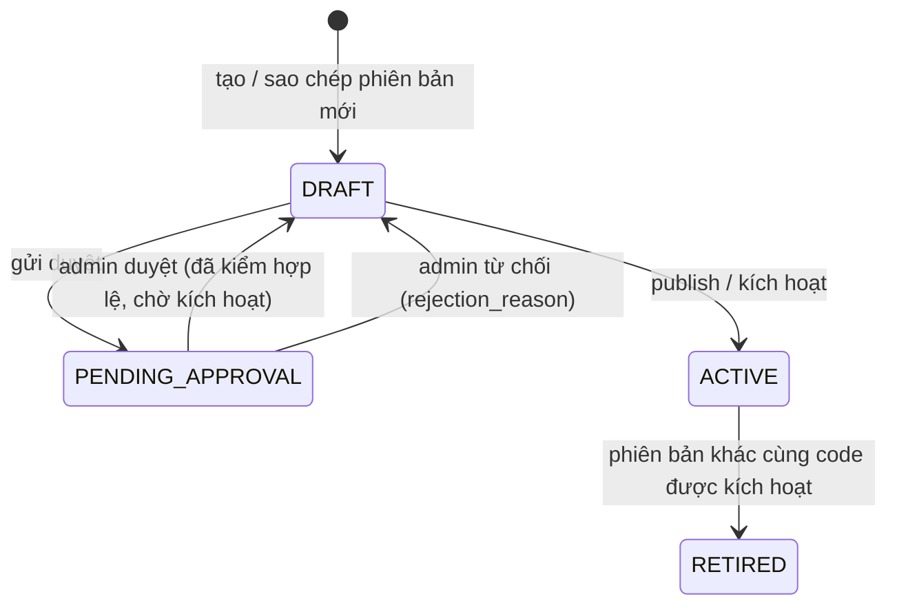

Điểm bất thường cần ghi rõ trên sơ đồ: code hiện tại đưa mẫu đề về `DRAFT` cả khi duyệt lẫn khi từ chối. Hai trường hợp chỉ phân biệt được bằng `rejection_reason` và audit log. Nếu muốn có trạng thái `APPROVED` riêng, phải đổi enum và V2 migration, nên đưa vào backlog thay vì vẽ một trạng thái không tồn tại.

`ExamBlueprint`: `DRAFT` → `PENDING_APPROVAL` → `PUBLISHED`; trả về `DRAFT` khi bị từ chối. `PUBLISHED` được đặt khi sinh snapshot (`SnapshotPublishService`).

### 8.8 Organization (`tenancy/domain/Organization.java`)

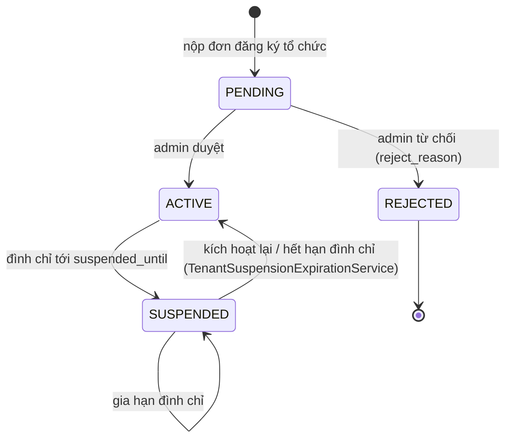

`User.status`: `ACTIVE` ⇄ `SUSPENDED`. `OrganizationMember.status`: `ACTIVE` ⇄ `SUSPENDED`. `Program` / `Class`: `ACTIVE` / `INACTIVE` / `SUSPENDED`.

### 8.9 Billing: Order, Subscription, LicenseCode

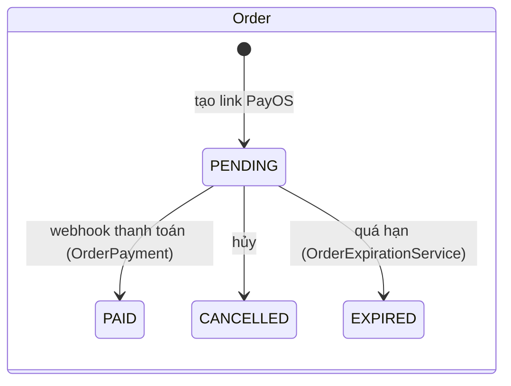

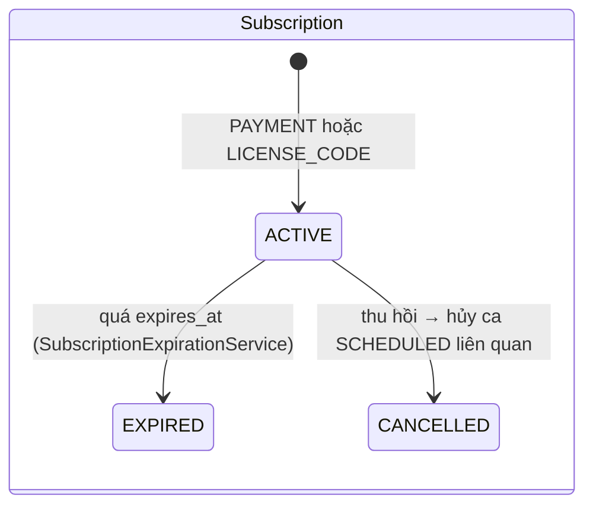

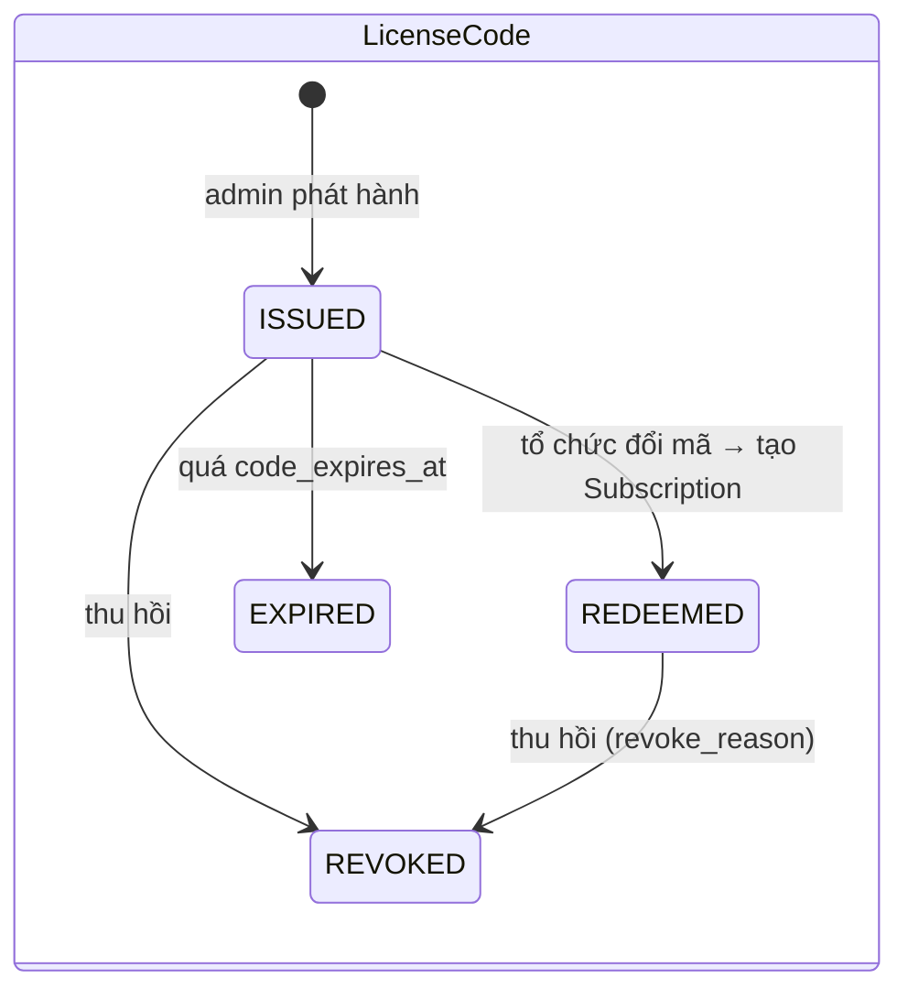

Mọi cạnh của Order và Subscription chỉ đi ra từ `PENDING` / `ACTIVE`. Gọi lại khi đã ở trạng thái cuối thì không có tác dụng (idempotent), không ném lỗi. Ghi điều này dưới sơ đồ.

`ServicePlan`: `DRAFT` → `ACTIVE` → `ARCHIVED`.

### 8.10 PracticeSession (`practice/internal/service/session/`)

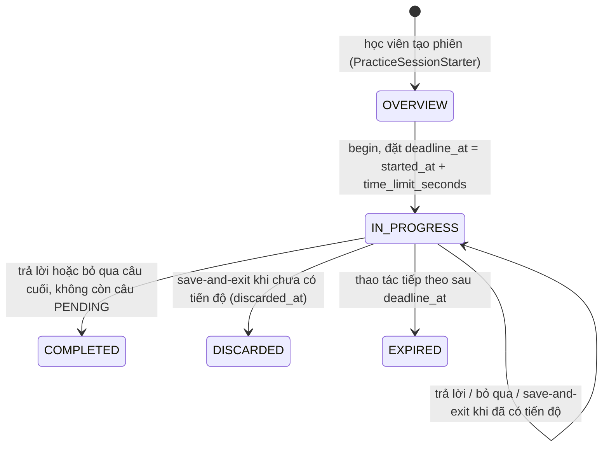

Ghi chú khi vẽ:

- `OVERVIEW` không hết hạn, vì `deadline_at` chỉ được đặt lúc begin.
- Hết hạn là kiểu "lười": không có worker. `PracticeSessionStateGuard.expireIfNeeded` chuyển sang `EXPIRED` khi học viên đọc hoặc thao tác lại sau `deadline_at`. Nếu đang lưu câu trả lời, API trả HTTP 410 `PRACTICE_SESSION_EXPIRED`.
- Mỗi thao tác kèm `clientVersion` (optimistic) và idempotency key (`PRACTICE_SESSION_OP`).

`PracticeResponse.status`: `PENDING` → `ANSWERED` | `SKIPPED`. `scoring_status`: `NONE` → `SCORING` → `SCORED` | `FAILED`.

### 8.11 SupportTicket (`support/domain/SupportTicket.java`)

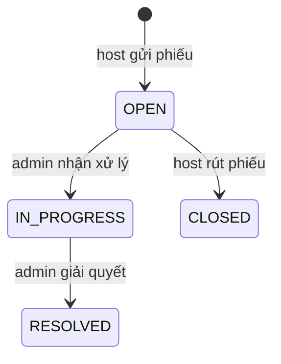

### 8.12 ExamIncident (`proctoring/internal/service/ExamIncidentCommandService.java`)

`status` là `String` (hằng số trong `ExamIncidentConstants`), không phải enum và không có CHECK trong V1. Năm giá trị hợp lệ: `NEW`, `IN_PROGRESS`, `ESCALATED`, `RESOLVED`, `CLOSED`. Chỉ incident có `origin = REPORTED` mới đổi trạng thái được qua API. Chữ "OPEN" trong `ProctorStompController` là tên thao tác STOMP, không phải trạng thái.

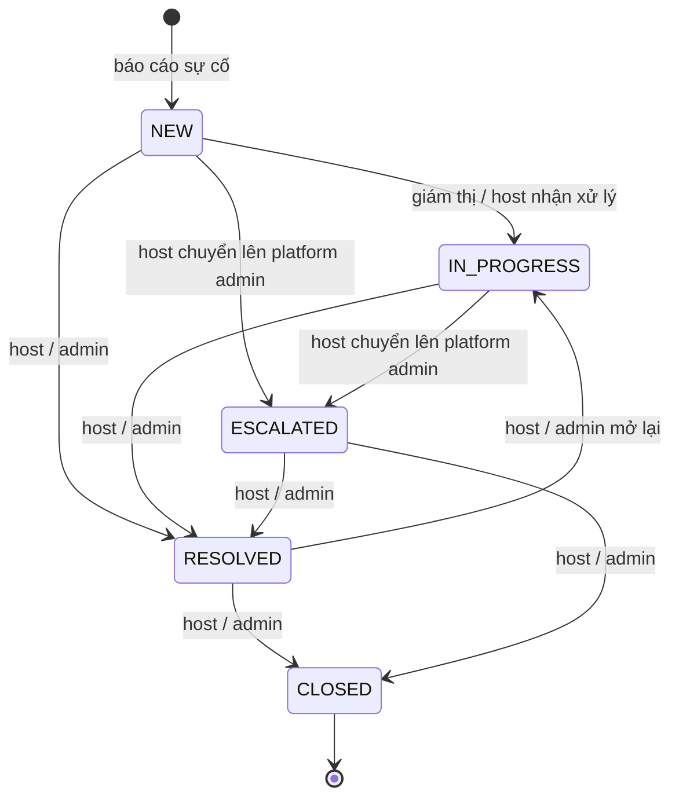

Luật cần ghi dưới sơ đồ:

- `CLOSED` là trạng thái cuối, không ai đổi được (`CLOSED_INCIDENT_IMMUTABLE`).
- Giám thị chỉ được đặt `NEW` hoặc `IN_PROGRESS`, không được đưa `IN_PROGRESS` về `NEW`, không được động vào incident đã `RESOLVED` / `ESCALATED`. Mọi thay đổi của giám thị chuyển `current_owner_role` về `HOST_ADMIN`.
- Host và platform admin được đặt bất kỳ giá trị hợp lệ nào khi incident chưa `CLOSED`. Code không giới hạn thứ tự. Sơ đồ trên chỉ vẽ các cạnh có nghĩa nghiệp vụ; ghi rõ "host/admin có thể chuyển giữa mọi trạng thái chưa đóng". `ESCALATED` đặt `current_owner_role = PLATFORM_ADMIN`.
- Lịch sử chuyển trạng thái nằm trong `IncidentHistoryLog` và audit log (`INCIDENT_CHANGED`).

### 8.13 NotificationRecipient (`notification/internal/repository/InboxDeliveryStore.java`)

Hàng đợi giao thông báo vào inbox, chạy bằng lease và claim token:

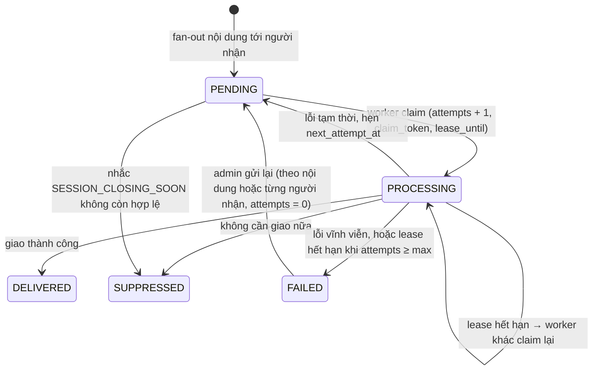

`NotificationLog` (email) đơn giản hơn: `PENDING` → `SENT` | `FAILED`.

### 8.14 Entity có vòng đời đơn giản (ghi chú, không cần sơ đồ riêng)

| Entity | Vòng đời |
|---|---|
| `MediaAsset` | `PENDING_UPLOAD` → `UPLOADED` (`markUploaded`, sau khi `CloudinaryUploadVerifier` xác nhận). Chỉ media `UPLOADED` có `secure_url` mới đọc được. |
| `QuestionType` | `lifecycle_status` là `String`: `DRAFT` → `PENDING_APPROVAL` (submit) → `ACTIVE` (approve) → `RETIRED` (retire, không kiểm trạng thái trước). Platform admin tạo hoặc sửa thì đặt thẳng `ACTIVE` / `INACTIVE`; người khác sửa thì quay về `DRAFT`. Cờ `active` đi kèm nhưng không luôn đồng bộ: admin sửa có thể đặt `active = false` mà `lifecycle_status` vẫn là `ACTIVE`. |
| `User`, `OrganizationMember` | `ACTIVE` ⇄ `SUSPENDED` |
| `Program`, `TrainingClass` | `ACTIVE` / `INACTIVE` / `SUSPENDED` |
| `GradingIssue` | `OPEN` → `RESOLVED` |

### 8.15 Điểm lệch giữa enum và code (đưa vào backlog, không vẽ)

| Vị trí | Vấn đề |
|---|---|
| `AudienceMemberStatus.CANDIDATE` | Có trong enum và CHECK nhưng không bao giờ được gán |
| `ExamDefinition` | Duyệt và từ chối đều về `DRAFT` (xem 8.7) |
| `ExamIncident.status`, `QuestionType.lifecycle_status` | Kiểu chuỗi, không có enum hay CHECK; nên đổi sang enum bằng migration `V2+` |
| `QuestionType.active` vs `lifecycle_status` | Hai trường có thể mâu thuẫn |

## 9. Quy trình làm

1. Chạy V1 trên Postgres trống, sinh D3 tự động để có danh sách bảng và FK chuẩn.
2. Vẽ D2 theo từng nhóm ở mục 6, đối chiếu với lớp `@Entity`.
3. Rút gọn D2 thành D1: bỏ thuộc tính, bỏ bảng kỹ thuật, đổi tên sang khái niệm nghiệp vụ.
4. Vẽ D0 từ D1, đối chiếu với ADR-001 / ADR-008.
5. Vẽ D4: mỗi mũi tên phải chỉ được tới một phương thức hoặc service. Mũi tên nào không tìm thấy trong code thì không vẽ, ghi vào mục "cần xác minh".
6. Dán từng `.mmd` vào draw.io để dựng bản trình bày. Thêm link thư mục `erd/` vào `pte-doc/projects/architecture/README.md`.

## 10. Checklist trước khi chốt

- [ ] Mỗi bảng trong V1 xuất hiện đúng một lần ở D3 (52 bảng).
- [ ] FK thật vẽ nét liền, tham chiếu logic vẽ nét đứt. Có đủ 19 FK của mục 3.1.
- [ ] Ba lớp evaluation được vẽ là một bảng `answer_evaluations` với cột `source` phân biệt.
- [ ] D1 không chứa bảng kỹ thuật (token, OTP, idempotency, audit, stream, snapshot).
- [ ] Tên trạng thái ở D4 trùng nguyên văn với enum / CHECK trong V1.
- [ ] Mỗi mũi tên ở D4 có hành động hoặc tác nhân (host, admin, worker, học viên).
- [ ] Các điểm lệch ở mục 8.15 được ghi chú cạnh sơ đồ liên quan, không vẽ thành trạng thái hay cạnh không tồn tại (ví dụ `CANDIDATE`, `APPROVED` của ExamDefinition).
- [ ] Không có tên bảng hay entity cũ trước đợt gộp, chẳng hạn các bảng chấm điểm, incident hay ghi danh riêng lẻ trước đây.
- [ ] File `.mmd` render được bằng `mmdc` mà không lỗi cú pháp.
